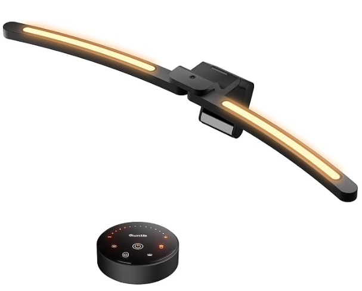
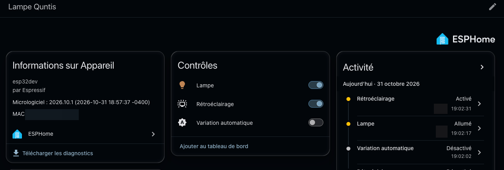

# Quntis LI-HY-0213-GY in Home Assistant

Control a Quntis curved monitor light bar from Home Assistant with an ESP32 and an nRF24L01+ radio module. It works locally: no cloud, no app, and no change to the lamp or its remote.



*The Quntis LI-HY-0213-GY and its remote. Product photo: Quntis.*

This work is inspired by [bluemaex/Quntis-LED-Controller](https://github.com/bluemaex/Quntis-LED-Controller), itself based on the reverse engineering of [Lexy1972](https://github.com/Lexy1972/Reverse-Engineer-a-Quntis-Monitor-LED-Bar-Controller). This fork adds support for the LI-HY-0213-GY. If you own the PRO+ (LI-HY-208-BK), use the [original project](https://github.com/bluemaex/Quntis-LED-Controller) instead: the protocols are different.

This has been tested on one lamp and one remote only. The values and behavior below may differ on another unit.

## The lamp

| | |
|---|---|
| **Product** | Quntis curved monitor light bar Plus, 66 cm |
| **Model** | LI-HY-0213-GY |
| **Amazon ASIN** | [B0F6CRKG68](https://www.amazon.ca/dp/B0F6CRKG68) |
| **Manufacturer** | Northland Supply Chain Management (Dongguan) |
| **Remote** | Wireless, 2.4 GHz |

The remote has these controls:

| Control | What it does |
|---|---|
| Power | Turns the lamp on or off, including the backlight |
| Brightness button, then + or − | Moves through four brightness levels |
| Color temperature button, then + or − | Moves through 3000, 4000, 5000 and 6500 K |
| Backlight button | Turns the backlight on or off |
| Automatic dimming button | Lets the lamp adjust its brightness to the room, when the lamp is on |

## What you get in Home Assistant



| Entity | Controls |
|---|---|
| Light | On/off, brightness, and color temperature from 3000 to 6500 K |
| Backlight switch | The backlight, independently of the main light |
| Automatic dimming switch | The lamp's automatic dimming |

The lamp accepts absolute values, so there is no step counting and no calibration. Brightness and color temperature are not limited to the remote's presets. Home Assistant goes down to the remote's lowest level, about 10 %, because lower levels have not been tested.

## What you need

- A DOIT ESP32 DevKit V1, or another ESP32 if you adapt the pins
- An nRF24L01+ module, the small version with a PCB antenna
- 7 female-to-female jumper wires
- A USB cable that carries data, then a USB charger for permanent use

| nRF24L01+ | ESP32 DevKit V1 |
|---|---|
| VCC | 3V3, never 5V |
| GND | GND |
| CE | GPIO17 (TX2) |
| CSN | GPIO5 (D5) |
| SCK | GPIO18 (D18) |
| MOSI | GPIO23 (D23) |
| MISO | GPIO19 (D19) |
| IRQ | Not connected |

## Setup

### 1. Capture your remote's values

1. Open `arduino/Quntis Sniffer` in PlatformIO and flash it.
2. Open the serial monitor at 115200 baud.
3. Send `s80,10`. The blue LED lights up for 10 seconds.
4. Hold the remote about 1 cm from the module and press power repeatedly.

You should see lines like this:

```
PKT,784,AABBCCDDEE1122334455...
```

- The first 5 bytes after the timestamp are your `device_address`.
- The next 4 bytes give your `remote_id`: XOR them with `BC E5 66 0D`, then reverse the bits of each byte.

If nothing shows up, turn off other 2.4 GHz devices nearby. A second ESP32 hid the remote during development. If your unit does not use channel 80, send `a3` and press a button whenever the blue LED is on: it prints the activity of every channel, with and without presses.

### 2. Configure ESPHome

Copy `example-esphome-0213-config.yaml` to a new file and replace these values:

```yaml
channel: 80
device_address: [0x00, 0x00, 0x00, 0x00, 0x00]
remote_id: [0x00, 0x00, 0x00, 0x00]
```

Then create a `secrets.yaml` file next to it:

```yaml
wifi_ssid: "your network"
wifi_password: "your password"
```

The example config loads the component from the local `components` folder. To build it from another folder, point `external_components` to this repository.

### 3. Flash and add it to Home Assistant

```bash
uvx --python 3.12 esphome run your-config.yaml
```

Use a 2.4 GHz network that can reach Home Assistant. Then add the device under **Settings → Devices & services**, if it is not discovered automatically. Once it works, you can power the ESP32 from a USB charger near the lamp.

## How it was reverse engineered

The lamp came with no public documentation of its radio link, and the existing project did not work on it. The sniffer written for the PRO+ listens on channel 2, and it heard nothing from this remote.

The first attempts with a nearby 2.4 GHz channel scan looked like a dead end:

- Wi-Fi hid weak signals, because the scan only displayed the busiest channels.
- A second ESP32 plugged into the same computer filled 2409 to 2415 MHz with traffic and created a false lead.
- A short remote packet is easy to miss when the receiver only samples each channel briefly.

What finally worked:

1. **An alternating scan.** With the second ESP32 unplugged, the firmware alternated silence and button presses, signaled by its blue LED. Activity near 2453 and 2480 MHz rose during each press phase.
2. **A full capture on channel 80.** The firmware kept every frame received without assuming a protocol. A bit sequence appeared hundreds of times during presses, and never in silence.
3. **The XN297 signature.** Once shifted by two bits, the frames began with `71 0F 55`: the sync used by the XN297 radio chip, as on the PRO+.
4. **Replaying a packet.** Sending a captured packet back made the lamp react.
5. **Decoding the fields.** The XN297 scrambling and bit order were already known from the earlier projects. Captures of each button then showed what each byte means. The checksum and CRC formulas rebuild all 155 reliable captured packets byte for byte.
6. **Computed packets.** The lamp accepted packets it had never received from the remote, including a 50 % level and an intermediate color temperature.

## Protocol

The radio settings are channel 80 (2480 MHz), 1 Mbps, one-way, with the nRF24 CRC disabled. The remote repeats each packet in short bursts.

After the `71 0F 55` sync, the raw packet holds a 5-byte address, 11 data bytes, a 2-byte CRC, then `AF`. To decode a data byte, XOR it with the XN297 scramble table, then reverse its bits.

```
[remote id x4] [command] [brightness] [color temp] [backlight] 00 [counter] [sum]
```

| Field | Values |
|---|---|
| Brightness | `00` turns off the main light. The remote uses `1A`, `55`, `A9` and `FF`. |
| Color temperature | The remote uses `00`, `47`, `A2` and `FF`, from warmest to coldest. |
| Backlight | `00` off, `FF` on. |
| Counter | Goes up with each press. |
| Sum | The sum of the 10 previous bytes, modulo 256. |
| CRC | CRC-16 over the raw address and data: polynomial `0x1021`, init `0xB5D2`, final XOR `0xF494`. |

| Command | Button |
|---|---|
| `30` | Brightness button |
| `31` | Power |
| `32` | Backlight |
| `34` | Color temperature button |
| `35`, `36` | Brightness + and − |
| `39`, `3A` | Color temperature + and − |
| `40`, `3E` | Automatic dimming on and off |

The manual lists brightness levels of 10, 50, 75 and 100 %. The captured values are closer to 10, 33, 66 and 100 %.

## Sniffer commands

Send these to `arduino/Quntis Sniffer` over serial at 115200 baud.

| Command | What it does |
|---|---|
| `i` | Checks the radio module |
| `a<pairs>` | Scans every channel, alternating silence and presses |
| `l<channel>,<rate>,<pairs>` | Listens to a channel and counts repeated frames |
| `r<channel>,<rate>,<pairs>` | Same, and prints every captured frame |
| `s<channel>,<seconds>` | Prints packets that use the XN297 sync |
| `t<channel>,<count>,<hex>` | Sends raw bytes after the XN297 sync |

For `<rate>`, use `0` for 1 Mbps, `1` for 2 Mbps or `2` for 250 kbps. This firmware replaces the project's original PRO+ sniffer on this branch.

## Limitations

- **No feedback:** the lamp never reports its state. If you use the remote, Home Assistant does not know.
- **Full state in each packet:** a command also sends the brightness, color temperature and backlight Home Assistant knows about.
- **After a restart:** Home Assistant shows everything as off, and the ESP32 sends nothing until the next command.
- **Automatic dimming:** the brightness slider does not show the real level while this mode is on. The switch needs the lamp to be on, and it also turns on the backlight, like the remote.
- **Backlight:** this is on or off only. The remote's continuous adjustment is not supported.
- **Security:** the example config uses no API encryption or OTA password. Anyone on your network could control the lamp or update the ESP32. Add both if your network is shared.
- **Coexistence:** other 2.4 GHz devices may interfere. Running it next to a second ESP32 has not been tested after setup.

## Credits

- [Lexy1972](https://github.com/Lexy1972/Reverse-Engineer-a-Quntis-Monitor-LED-Bar-Controller) reverse engineered the PRO+ and identified the XN297.
- [bluemaex](https://github.com/bluemaex/Quntis-LED-Controller) ported that work to the ESP32 and ESPHome.
- The LI-HY-0213-GY work was done by [gharl77](https://github.com/gharl77) with [Claude Code](https://claude.com/claude-code).

The MQTT and PRO+ ESPHome code from the original project are in [its repository](https://github.com/bluemaex/Quntis-LED-Controller).
