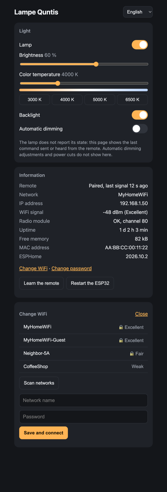

# Quntis LI-HY-0213-GY in Home Assistant

Control a Quntis curved monitor light bar from Home Assistant with an ESP32 and an nRF24L01+ radio module. It works locally: no cloud, no app, and no change to the lamp or its remote.


*The Quntis LI-HY-0213-GY and its remote. Product photo: Quntis.*

This work is inspired by [bluemaex/Quntis-LED-Controller](https://github.com/bluemaex/Quntis-LED-Controller), itself based on the reverse engineering of [Lexy1972](https://github.com/Lexy1972/Reverse-Engineer-a-Quntis-Monitor-LED-Bar-Controller). This fork adds support for the LI-HY-0213-GY. If you own the PRO+ (LI-HY-208-BK), use the [original project](https://github.com/bluemaex/Quntis-LED-Controller) instead: the protocols are different.

This has been tested on one lamp and one remote only. The values and behavior below may differ on another unit.

## The lamp

| | |
|---|---|
| **Product** | Quntis curved monitor light bar Plus, 66 cm |
| **Model** | LI-HY-0213-GY |
| **Amazon ASIN** | [B0F6CRKG68](https://www.amazon.ca/dp/B0F6CRKG68) |
| **Manufacturer** | Northland Supply Chain Management (Dongguan) |
| **Remote** | Wireless, 2.4 GHz |

The remote has these controls:

| Control | What it does |
|---|---|
| Power | Turns the lamp on or off, including the backlight |
| Brightness button, then + or − | Moves through four brightness levels |
| Color temperature button, then + or − | Moves through 3000, 4000, 5000 and 6500 K |
| Backlight button | Turns the backlight on or off |
| Automatic dimming button | Lets the lamp adjust its brightness to the room, when the lamp is on |

## What you get

### In Home Assistant


| Entity | What it does |
|---|---|
| Light | On/off, brightness from 1 to 100 %, and color temperature from 3000 to 6500 K |
| Backlight switch | The backlight, independently of the main light |
| Automatic dimming switch | The lamp's automatic dimming |
| Remote event | One event per press on the remote, to trigger your own automations |
| Learn the remote button | Pairs the ESP32 with your remote |
| Diagnostic counters | Radio packets received, and presses recognized from your remote |

- **Absolute values:** the lamp accepts any brightness and color temperature, not only the remote's presets. There is no step counting and no calibration.
- **The remote stays in sync:** the ESP32 listens to the remote, so Home Assistant follows what you change with it.
- **Fades:** brightness and color temperature change over 1 second, like a smart bulb. Set `default_transition_length: 0s` to change at once. How smooth this looks has not been checked.
- **After a restart:** the ESP32 shows the last known state again.

The remote event has these types: `power`, `brightness`, `brightness_up`, `brightness_down`, `temperature`, `temperature_up`, `temperature_down`, `backlight`, `auto_dim`, `button_33` and `other`. In an automation, use the remote's event entity (**Télécommande** in the example) as the trigger, then check its `event_type` attribute. The lamp still reacts to the remote as usual.

### The lamp's own web page

The ESP32 also serves its own page, so the lamp works without Home Assistant. In Home Assistant, the **Visit** link on the device page opens it. You can also open `http://<ESP32 address>/`.



*The page with its WiFi panel open. The network names and addresses are sample data.*

| Section | What it does |
|---|---|
| Light | On/off, brightness, color temperature with presets, backlight and automatic dimming |
| Information | Remote status, network, IP address, WiFi signal, radio module status, uptime, free memory, MAC address and ESPHome version |
| Learn the remote | Pairs the next remote heard |
| Change WiFi | Scans nearby networks, then saves a new network and password |
| Change password | Replaces the page's password |
| Restart | Restarts the ESP32 |

The page is in French and English. It follows the browser's language, and the menu at the top changes it.

## What you need

- A DOIT ESP32 DevKit V1, or another ESP32 if you adapt the pins
- An nRF24L01+ module, the small version with a PCB antenna
- 7 female-to-female jumper wires
- A USB cable that carries data, then a USB charger for permanent use

| nRF24L01+ | ESP32 DevKit V1 |
|---|---|
| VCC | 3V3, never 5V |
| GND | GND |
| CE | GPIO17 (TX2) |
| CSN | GPIO5 (D5) |
| SCK | GPIO18 (D18) |
| MOSI | GPIO23 (D23) |
| MISO | GPIO19 (D19) |
| IRQ | Not connected |

Keep the module connected for good: it sends the commands to the lamp and hears the remote.

## Quick install

1. Wire the module, then plug the ESP32 into a computer.
2. Open the [installer page](https://gharl77.github.io/Quntis-LED-Controller/) in Chrome or Edge, then click **Install**.
3. When it asks, choose your WiFi network and enter its password.
4. Open the lamp's page, click **Learn the remote**, then press a button on the remote right next to the module.
5. Add the device in Home Assistant under **Settings → Devices & services**.

This firmware has no page password and no update password, and its backup network uses the public password `quntis1234`. To change them, adopt the device in ESPHome Builder: it imports the configuration from this repository.

## Manual install

Use this to change the pins, the names, or the passwords.

1. Copy `example-esphome-0213-config.yaml` to a new file.
2. Create a `secrets.yaml` file next to it:

   ```yaml
   wifi_ssid: "your network"
   wifi_password: "your password"
   ap_password: "at least 8 characters, for the backup network"
   ota_password: "a password for firmware updates"
   web_password: "a password for the web page"
   ```

3. Flash it over USB the first time:

   ```bash
   uvx --python 3.12 esphome run your-config.yaml
   ```

4. Learn the remote from the page or from Home Assistant, as in the quick install.

The page asks for the user `admin` and your `web_password`. If you change it from the page, the new password stays until you change `web_password` in `secrets.yaml` and flash again.

The example loads the components from the local `components` folder. To build it from another folder, point `external_components` to this repository. The components were tested with ESPHome 2026.10. A newer release shows a warning when building, and it may need changes.

### Options

| Option | Default | What it does |
|---|---|---|
| `channel` | `80` | The radio channel. See the sniffer if your unit uses another one |
| `device_address`, `remote_id` | Learned | Your remote's values, if you prefer to set them by hand |
| `min_level` | `0x03` | The lowest brightness sent, about 1 %. The remote's lowest is `0x1A` |
| `on_remote` | | An automation run on each press, with the button's name in `button` |

## If the WiFi stops working

If the ESP32 cannot join a network for about a minute, it starts its own WiFi, `Lampe Quntis`. Connect to it with your `ap_password`, or `quntis1234` with the quick install. A page then lists nearby networks.

While it is disconnected, you can also set the WiFi over Bluetooth with [Improv WiFi](https://www.improv-wifi.com/) in Chrome or Edge, or from Home Assistant's Bluetooth discovery.

A network saved from the page, the backup network or Bluetooth replaces the one in `secrets.yaml`, even after a firmware update.

## Security

- **Home Assistant connection:** it is encrypted. Home Assistant sends the key on its first connection, and the ESP32 then refuses unencrypted connections. `esphome logs` then needs that key too.
- **Firmware updates:** they need your `ota_password`, or the key that Home Assistant sent.
- **Web page:** in the manual install, it needs the user `admin` and a password. The backup network's page stays open, but that network has its own password.
- **Bluetooth:** anyone nearby can set the WiFi while the ESP32 is disconnected.
- **Commands from other websites:** the page refuses them, even from a browser that is signed in to it.

## How it was reverse engineered

The lamp came with no public documentation of its radio link, and the existing project did not work on it. The sniffer written for the PRO+ listens on channel 2, and it heard nothing from this remote.

The first attempts with a nearby 2.4 GHz channel scan looked like a dead end:

- Wi-Fi hid weak signals, because the scan only displayed the busiest channels.
- A second ESP32 plugged into the same computer filled 2409 to 2415 MHz with traffic and created a false lead.
- A short remote packet is easy to miss when the receiver only samples each channel briefly.

What finally worked:

1. **An alternating scan.** With the second ESP32 unplugged, the firmware alternated silence and button presses, signaled by its blue LED. Activity near 2453 and 2480 MHz rose during each press phase.
2. **A full capture on channel 80.** The firmware kept every frame received without assuming a protocol. A bit sequence appeared hundreds of times during presses, and never in silence.
3. **The XN297 signature.** Once shifted by two bits, the frames began with `71 0F 55`: the sync used by the XN297 radio chip, as on the PRO+.
4. **Replaying a packet.** Sending a captured packet back made the lamp react.
5. **Decoding the fields.** The XN297 scrambling and bit order were already known from the earlier projects. Captures of each button then showed what each byte means. The checksum and CRC formulas rebuild all 155 reliable captured packets byte for byte.
6. **Computed packets.** The lamp accepted packets it had never received from the remote, including a 50 % level and an intermediate color temperature.

## Protocol

The radio settings are channel 80 (2480 MHz), 1 Mbps, with the nRF24 CRC disabled. The lamp only receives. The remote sends each press about 14 times, with the same counter.

After the `71 0F 55` sync, the raw packet holds a 5-byte address, 11 data bytes, a 2-byte CRC, then `AF`. To decode a data byte, XOR it with the XN297 scramble table, then reverse its bits.

```
[remote id x4] [command] [brightness] [color temp] [backlight] 00 [counter] [sum]
```

| Field | Values |
|---|---|
| Brightness | `00` turns off the main light. The remote uses `1A`, `55`, `A9` and `FF`. The tested lamp stays steady down to `03`. |
| Color temperature | The remote uses `00`, `47`, `A2` and `FF`, from warmest to coldest. |
| Backlight | `00` off, `FF` on. |
| Counter | Goes up with each press. |
| Sum | The sum of the 10 previous bytes, modulo 256. |
| CRC | CRC-16 over the raw address and data: polynomial `0x1021`, init `0xB5D2`, final XOR `0xF494`. |

| Command | Button |
|---|---|
| `30` | Brightness button |
| `31` | Power |
| `32` | Backlight |
| `33` | Unknown |
| `34` | Color temperature button |
| `35`, `36` | Brightness + and − |
| `39`, `3A` | Color temperature + and − |
| `40` | Automatic dimming |
| `3E` | Automatic dimming off, from the ESP32 |

- **Backlight button:** the remote always sends `FF`, and the lamp toggles its backlight. A packet from the ESP32 sets the value it carries.
- **Automatic dimming:** the remote sends `40` on every press, and the mode stays on. Changing the brightness stops it.

The manual lists brightness levels of 10, 50, 75 and 100 %. The captured values are closer to 10, 33, 66 and 100 %.

## Sniffer

You no longer need the sniffer to pair a remote. It remains useful if your unit does not use channel 80, or to study the protocol. Open `arduino/Quntis Sniffer` in PlatformIO, flash it, then send these commands over serial at 115200 baud.

| Command | What it does |
|---|---|
| `i` | Checks the radio module |
| `a<pairs>` | Scans every channel, alternating silence and presses |
| `l<channel>,<rate>,<pairs>` | Listens to a channel and counts repeated frames |
| `r<channel>,<rate>,<pairs>` | Same, and prints every captured frame |
| `s<channel>,<seconds>` | Prints packets that use the XN297 sync |
| `t<channel>,<count>,<hex>` | Sends raw bytes after the XN297 sync |

For `<rate>`, use `0` for 1 Mbps, `1` for 2 Mbps or `2` for 250 kbps. To find the channel, send `a3` and press a button whenever the blue LED is on. Turn off other 2.4 GHz devices nearby: a second ESP32 hid the remote during development.

## Limitations

- **No feedback from the lamp:** the ESP32 knows what it sent and what it heard from the remote. It does not see the adjustments of automatic dimming, or the lamp turning off after a power cut.
- **Missed presses:** a press far from the module, or while the ESP32 is sending, may not be heard.
- **Full state in each packet:** a command also sends the brightness, color temperature and backlight the ESP32 knows about.
- **Backlight:** this is on or off only. The remote may allow more, through the unknown `33` button.
- **Not tested:** the backup network, Bluetooth WiFi setup, the installer page, and a second lamp or remote.
- **Coexistence:** other 2.4 GHz devices may interfere.

## Credits

- [Lexy1972](https://github.com/Lexy1972/Reverse-Engineer-a-Quntis-Monitor-LED-Bar-Controller) reverse engineered the PRO+ and identified the XN297.
- [bluemaex](https://github.com/bluemaex/Quntis-LED-Controller) ported that work to the ESP32 and ESPHome.
- The LI-HY-0213-GY work was done by [gharl77](https://github.com/gharl77) with [Claude Code](https://claude.com/claude-code).

The MQTT and PRO+ ESPHome code from the original project are in [its repository](https://github.com/bluemaex/Quntis-LED-Controller).
